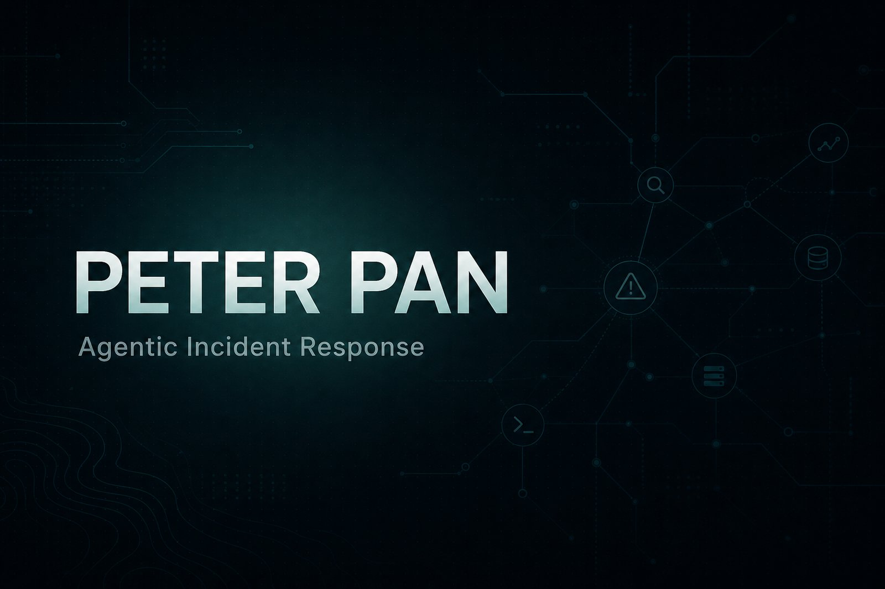
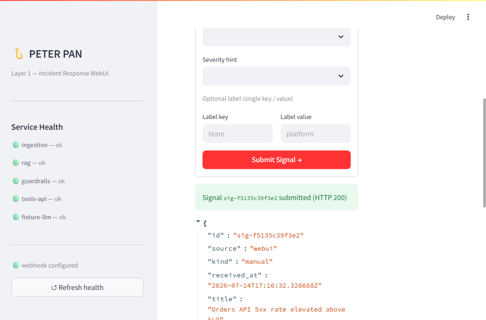
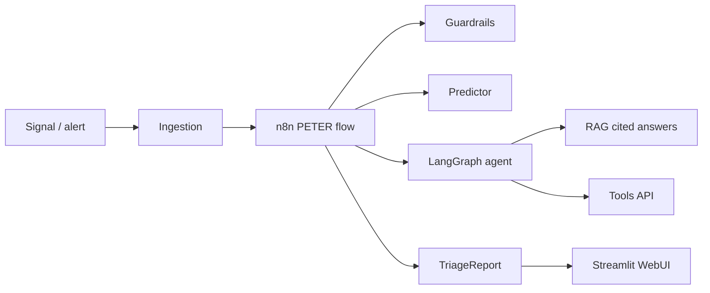

<div align="center">



# PETER PAN

**Something breaks. The system classifies it, finds what happened last time,  
checks itself for unsafe output, routes it to the right people, and writes the triage report.**

Self-hostable **agentic incident response** — n8n over FastAPI microservices,  
with deterministic safety floors that override the LLM when it matters.

[](https://github.com/reem-mor/peter-pan.io/actions/workflows/ci.yml)
[](https://www.python.org/)
[](https://fastapi.tiangolo.com/)
[](https://n8n.io/)
[](LICENSE)

[Quick start](#quick-start) · [Architecture](#architecture) · [Demo](#demo) · [Docs](#documentation) · [What this is not](#what-this-is-not)

</div>

---

<details open>
<summary><strong>Operator console — signal in, triage out</strong></summary>

<br/>

<p align="center">
  
</p>

<p align="center"><em>Layer 1 Streamlit WebUI — service health, manual signal submit, transparent JSON response.</em></p>

</details>

---

## Why this exists

Built from a NOC / ops background: alert fatigue is real, and LLM triage without hard floors is unsafe in production.

**Mid-term → final:** [PITER](docs/PRODUCT-STORY.md) connected **Knowledge → RAG**.
**PETER PAN** connects **Observability → Monitoring** — a full four-layer triage
product (UI · n8n · FastAPI · models). The course real-estate guideline is only a
**capability map**; the product domain is AIOps.

→ Full narrative + competitive landscape: **[Product story](docs/PRODUCT-STORY.md)**

| Constraint | Choice |
|:---|:---|
| Demo must work offline | **Fixture-first** — zero external API calls on the golden path |
| LLM can invent severity / route | **Deterministic floors** — regex guardrails + EWMA/z-score predictor win |
| Contracts drift kills integrations | **Frozen schemas** — `{passed, flags, reason}` · 6 `incident_class` · P1–P4 only |

<details>
<summary><strong>Numbers that matter</strong></summary>

| Signal | Value |
|:---|:---|
| Graded Layer 3 services | 4 (RAG · Predictor · Guardrails · LangGraph) |
| n8n spine | 8 nodes |
| Predictor classes | 6 → routed to 3 lanes in n8n |
| Severity | P1–P4 (no P5) |
| Target demo | 5–8 minutes, golden `orders-api` path |

</details>

---

## Architecture — four layers

n8n is the conductor — it plays no instrument; FastAPI services own the logic.
Canonical write-up: **[docs/ARCHITECTURE.md](docs/ARCHITECTURE.md)**.



| Layer | What | Where |
|:---|:---|:---|
| 1 · Experience | Streamlit operator console | [`ui/`](ui/README.md) |
| 2 · Orchestration | 8-node PETER flow | [`n8n/`](n8n/README.md) |
| 3 · Platform services | Graded FastAPI + support seams | [`services/`](services/README.md) |
| 4 · Model tier | Task-routed `LLMClient` (fixture → Bedrock / Gemini / Ollama / Llama.cpp) | [`docs/llm_client/`](docs/llm_client/README.md) |

**Graded L3:** RAG · Predictor · Guardrails · LangGraph agent  
**Supporting L3:** Ingestion · Tools API · Dashboard Generator · Image Analyzer · Fixture LLM

<details>
<summary><strong>Source-of-truth diagrams & ADRs</strong></summary>

- [Architecture](docs/ARCHITECTURE.md)
- [Product story — PITER → PETER PAN](docs/PRODUCT-STORY.md)
- [System topology](docs/peter-pan-system.mmd)
- [n8n flow](docs/peter-pan-n8n-flow.mmd)
- [Build plan](docs/BUILD_PLAN.md)
- [ADR 0002 — model / memory / DB](docs/adr/0002-model-memory-db.md)
- [ADR 0003 — system boundaries](docs/adr/0003-system-boundaries.md)
- [ADR 0004 — guardrail & predictor contracts](docs/adr/0004-guardrail-and-predictor-contracts.md)

</details>

---

## Stack

| Area | Choice |
|:---|:---|
| Runtime | Python 3.12 · FastAPI · Pydantic v2 |
| Orchestration | n8n (versioned export in-repo) |
| UI | Streamlit |
| ML | PyTorch predictor (6 classes) + EWMA floor |
| RAG | Cited retrieval · no-context refusal |
| Infra | Docker Compose (local) · CloudFormation + single EC2 (demo) |
| Eval | Golden fixtures + compose-backed E2E harness |

---

## Repository layout (by layer)

```text
ui/                 Layer 1 — Experience (Streamlit)
n8n/                Layer 2 — Orchestration (PETER flow export + bootstrap)
services/           Layer 3 — FastAPI deployment units (one folder = one service)
docs/llm_client/    Layer 4 — LLMClient protocol (fixture + live providers)
evaluation/         Golden sets, E2E harness, rubric metrics
docs/               Architecture, contracts, ADRs, product story, diagrams
infra/aws/          CloudFormation demo stack (single EC2)
scripts/            Test runner, health checks, deploy helpers
fixtures/           Shared Grafana / demo assets
predictive/         Predictor training & synthetic metric windows
```

Each service under `services/` is self-contained — no cross-imports. Contracts are vendored copies with a parity test.

---

## Quick start

**Prerequisites:** Python 3.12 · Docker Desktop · Git — full detail in [docs/setup.md](docs/setup.md)

```powershell
git clone https://github.com/reem-mor/peter-pan.io.git
cd peter-pan.io

python -m venv .venv
.\.venv\Scripts\python.exe -m pip install -r requirements-dev.txt
Copy-Item .env.example .env
# Fill required secrets in .env — never commit that file.

.\.venv\Scripts\python.exe -m ruff check .
.\.venv\Scripts\python.exe scripts/run_all_tests.py
.\.venv\Scripts\python.exe evaluation/run_e2e.py --dry-run

docker compose --profile bootstrap up --build -d
# Full golden-path E2E (stack up + n8n bootstrapped):
.\.venv\Scripts\python.exe evaluation/run_e2e.py `
  --entrypoint n8n `
  --base-url http://localhost `
  --token $env:PETER_SERVICES_TOKEN
```

<details>
<summary><strong>More local workflows</strong></summary>

- Compose day-to-day: [docs/local-development.md](docs/local-development.md)
- EC2 demo: [docs/aws-deployment.md](docs/aws-deployment.md)
- Agent / MCP tooling: [docs/AGENT-TOOLING.md](docs/AGENT-TOOLING.md)
- Postman: [postman/peter-pan-core-apis.postman_collection.json](postman/peter-pan-core-apis.postman_collection.json)

</details>

---

## Demo

5–8 minute walkthrough of the golden `orders-api` incident path.

→ **[Demo guide](docs/demo-guide.md)** · [Full script](docs/presentation/DEMO-SCRIPT.md)

---

## Documentation

| Doc | Purpose |
|:---|:---|
| [PRODUCT-STORY.md](docs/PRODUCT-STORY.md) | PITER → PETER PAN · market · competitors |
| [ARCHITECTURE.md](docs/ARCHITECTURE.md) | Four layers, inventory, safety posture |
| [BUILD_PLAN.md](docs/BUILD_PLAN.md) | Stages, frozen contracts, build order |
| [PETER-PAN-SPEC-CROSSWALK.md](docs/PETER-PAN-SPEC-CROSSWALK.md) | Guideline → AIOps mapping + deviations |
| [setup.md](docs/setup.md) | Prerequisites and `.env` |
| [api.md](docs/api.md) | Service endpoints |
| [n8n-workflow.md](docs/n8n-workflow.md) | 8-node spine |
| [testing.md](docs/testing.md) | Pytest · E2E · rubric metrics |
| [security.md](docs/security.md) | Secrets · network · containers |
| [aws-deployment.md](docs/aws-deployment.md) | EC2 demo stack |
| [AGENT-TOOLING.md](docs/AGENT-TOOLING.md) | MCP · CI · Graphify |

---

## What this is not

Locked out of scope: Kubernetes multi-node · Terraform · live voice/bridge · Slack Block Kit HITL · feedback-loop retrain code · real production PII.

---

<div align="center">

[MIT License](LICENSE) · Built as portfolio-grade AIOps triage

</div>
