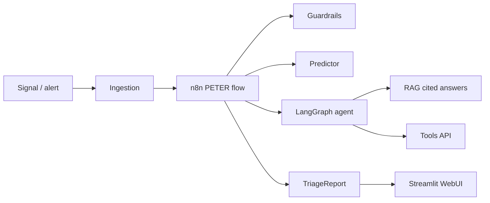

# PETER PAN

**Something breaks. The system classifies it, finds what happened last time, checks itself for unsafe output, routes it to the right people, and produces a triage report.**

PETER PAN is a self-hostable **agentic incident-response** platform: n8n orchestration over FastAPI microservices, with deterministic safety floors that override the LLM when it matters.

[CI](https://github.com/reem-mor/peter-pan.io/actions/workflows/ci.yml)
[License: MIT](LICENSE)


---


## Why this exists

Built from a NOC / ops background: alert fatigue is real, and LLM triage without hard floors is unsafe in production.

This project maps a graded AI-engineering rubric onto the **incident-ops** domain (AIOps instead of real estate). Same capabilities employers score — RAG, classification, guardrails, agent orchestration — demonstrated on synthetic checkout-tier incidents, not real customer data.


| Constraint                           | Choice                                                                                |
| ------------------------------------ | ------------------------------------------------------------------------------------- |
| Demo must work offline               | **Fixture-first** — zero external API calls on the golden path                        |
| LLM can hallucinate severity / route | **Deterministic floors** — regex guardrails + EWMA/z-score predictor win              |
| Contracts drift kills integrations   | **Frozen schemas** — `{passed, flags, reason}`, 6 `incident_class` values, P1–P4 only |


---


## Architecture

Four layers. n8n is the conductor — it does not own business logic; FastAPI services do.




| Layer             | What                                                      | Where                                        |
| ----------------- | --------------------------------------------------------- | -------------------------------------------- |
| 1 · UI            | Streamlit operator console                                | `[ui/](ui/)`                                 |
| 2 · Orchestration | 8-node PETER flow                                         | `[n8n/peter-flow.json](n8n/peter-flow.json)` |
| 3 · Services      | Graded FastAPI units + support seams                      | `[services/](services/)`                     |
| 4 · Models        | Task-routed `LLMClient` (fixture → Bedrock/Gemini/Ollama) | `[docs/llm_client/](docs/llm_client/)`       |


**Graded Layer 3 services:** RAG · Predictor · Guardrails · LangGraph agent  
**Supporting:** Ingestion · Tools API · Dashboard Generator · Image Analyzer · Fixture LLM

Diagrams (source of truth): [system](docs/peter-pan-system.mmd) · [n8n flow](docs/peter-pan-n8n-flow.mmd) · [build plan](docs/BUILD_PLAN.md)  
Decisions: [ADR 0002](docs/adr/0002-model-memory-db.md) · [ADR 0003](docs/adr/0003-system-boundaries.md) · [ADR 0004](docs/adr/0004-guardrail-and-predictor-contracts.md)

---


## Stack


| Area          | Choice                                                      |
| ------------- | ----------------------------------------------------------- |
| Runtime       | Python 3.12, FastAPI, Pydantic v2                           |
| Orchestration | n8n (versioned export in-repo)                              |
| UI            | Streamlit                                                   |
| ML            | PyTorch predictor (6 incident classes) + EWMA floor         |
| RAG           | Cited retrieval; no-context refusal                         |
| Infra         | Docker Compose (local) · CloudFormation + single EC2 (demo) |
| Eval          | Golden fixtures + compose-backed E2E harness                |


---


## Repository layout

```
services/          FastAPI deployment units (one folder = one service)
ui/                Streamlit WebUI
n8n/               PETER flow export + bootstrap
evaluation/        Golden sets, E2E harness, rubric metrics
docs/              Contracts, ADRs, runbooks, diagrams
infra/aws/         CloudFormation demo stack
scripts/           Test runner, health checks, deploy helpers
fixtures/          Shared Grafana / demo assets
predictive/        Predictor training & synthetic metric windows
```

Each service under `services/` is self-contained — no cross-imports between packages. Contracts are vendored copies with a parity test.

---


## Quick start

**Prerequisites:** Python 3.12, Docker Desktop, Git. Details: [docs/setup.md](docs/setup.md)

```powershell
git clone https://github.com/reem-mor/peter-pan.io.git
cd peter-pan.io

python -m venv .venv
.\.venv\Scripts\python.exe -m pip install -r requirements-dev.txt
Copy-Item .env.example .env
# Fill required secrets in .env — never commit that file.

.\.venv\Scripts\python.exe -m ruff check .
.\.venv\Scripts\python.exe scripts/run_all_tests.py
.\.venv\Scripts\python.exe evaluation/run_e2e.py --dry-run

docker compose --profile bootstrap up --build -d
# Full golden-path E2E (stack up + n8n bootstrapped):
.\.venv\Scripts\python.exe evaluation/run_e2e.py --entrypoint n8n --base-url http://localhost --token $env:PETER_SERVICES_TOKEN
```

Local compose workflow: [docs/local-development.md](docs/local-development.md)

---


## Demo

5–8 minute walkthrough of the golden `orders-api` incident path:

→ **[docs/demo-guide.md](docs/demo-guide.md)** · full script in [docs/presentation/DEMO-SCRIPT.md](docs/presentation/DEMO-SCRIPT.md)

---


## Documentation


| Doc                                         | Purpose                               |
| ------------------------------------------- | ------------------------------------- |
| [BUILD_PLAN.md](docs/BUILD_PLAN.md)         | Stages, frozen contracts, build order |
| [setup.md](docs/setup.md)                   | Prerequisites and `.env`              |
| [api.md](docs/api.md)                       | Service endpoints                     |
| [n8n-workflow.md](docs/n8n-workflow.md)     | 8-node spine                          |
| [testing.md](docs/testing.md)               | Pytest + E2E + rubric metrics         |
| [security.md](docs/security.md)             | Secrets, network, containers          |
| [aws-deployment.md](docs/aws-deployment.md) | EC2 demo stack                        |
| [AGENT-TOOLING.md](docs/AGENT-TOOLING.md)   | MCP, CI commands, Graphify            |


Postman collection: [postman/peter-pan-core-apis.postman_collection.json](postman/peter-pan-core-apis.postman_collection.json)

---


## What this is not

Out of scope by design (locked): Kubernetes multi-node, Terraform, live voice/bridge, Slack Block Kit HITL, feedback-loop retrain code, real production PII.

---


## License

[MIT](LICENSE)