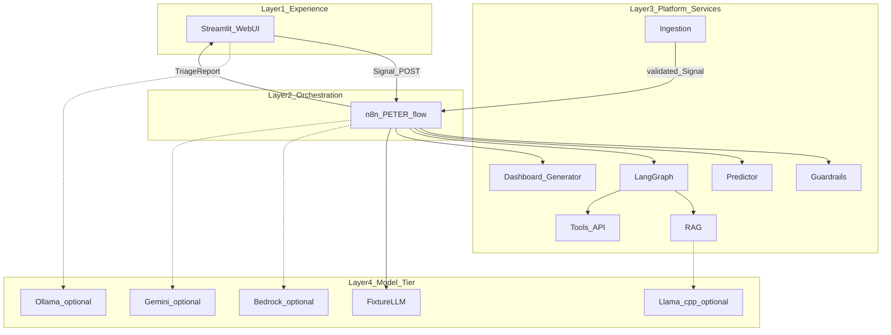

# Architecture — PETER PAN

Canonical four-layer architecture for the **AIOps incident-triage** product.
The course *AI Property Triage* guideline is a **capability checklist** only —
the product domain is incident operations, not real estate.

**Story / market positioning:** [`PRODUCT-STORY.md`](PRODUCT-STORY.md)  
**Build order & frozen contracts:** [`BUILD_PLAN.md`](BUILD_PLAN.md)  
**Diagrams (source of truth):** [`peter-pan-system.mmd`](peter-pan-system.mmd) ·
[`peter-pan-n8n-flow.mmd`](peter-pan-n8n-flow.mmd)  
**Boundaries:** [ADR 0003](adr/0003-system-boundaries.md) · **Models:** [ADR 0002](adr/0002-model-memory-db.md)

---

## 1. Design principles

| Principle | Practice |
|:---|:---|
| Four layers, HTTP between them | UI ↛ service imports; n8n orchestrates; services are deployment units |
| Models propose; code decides | Guardrail regex floor + EWMA/z-score predictor override LLM claims |
| Contracts frozen | `docs/contracts/contracts.py` vendored byte-identical into services |
| Fixture-first demo | Golden path runs with zero external LLM/API dependency |
| Synthetic data only | No real customer PII in corpus, fixtures, logs, or commits |
| Self-hostable | Docker Compose local; CloudFormation + single EC2 for demo |

---

## 2. The four layers



| Layer | Responsibility | Repo |
|:---|:---|:---|
| **1 · Experience** | Operator console: submit signal, render `TriageReport`, chat assistant | [`ui/`](../ui/README.md) |
| **2 · Orchestration** | 8-node PETER flow: rails → extract → agent → brief → route | [`n8n/`](../n8n/README.md) |
| **3 · Platform services** | Graded FastAPI microservices + supporting seams | [`services/`](../services/README.md) |
| **4 · Model tier** | Task-routed LLM clients; fixture seam for Stage A | [`docs/llm_client/`](llm_client/README.md) |

Anything not in the Mermaid diagrams is **out of scope** for the graded build
(see locked decisions in [`CLAUDE.md`](../CLAUDE.md)).

---

## 3. Layer 1 — Experience

- **Stack:** Streamlit, env-driven URLs, optional Ollama / Fixture LLM chat.
- **Jobs:** (1) Submit Alert → n8n webhook; (2) Assistant tab for ops Q&A.
- **Rules:** Never hang silently; show guardrail failures as first-class cards;
  demo path must work with fixtures (`DEMO_MODE` / fixture-llm).

Details: [`ui/README.md`](../ui/README.md)

---

## 4. Layer 2 — Orchestration (n8n)

Fixed 8-node spine (do not add/remove without approval):

1. Webhook → 2. Guardrails input → 3. IF → 4. Information Extractor →
5. AI Agent (tools) → 6. LLM Chain + Structured Output Parser →
7. Guardrails output → 8. Router (6→3 category map **lives only here**)

Export SoT: [`n8n/peter-flow.json`](../n8n/peter-flow.json). Re-export on every change.

Details: [`n8n/README.md`](../n8n/README.md) · [`n8n-workflow.md`](n8n-workflow.md)

---

## 5. Layer 3 — Platform services

### Graded core (course-mapped)

| Service | Endpoint(s) | Role |
|:---|:---|:---|
| RAG | `POST /query` | Cited similar incidents / runbooks; refuse if weak |
| Predictor | `POST /analyse` | 6 `incident_class` + confidence; EWMA floor |
| Guardrails | `POST /check/input`, `/check/output` | `{passed, flags, reason}` |
| LangGraph agent | `POST /agent/run` | Planner → specialists (RAG, Tools) → synthesis |

### Supporting seams (declared deviation — ADR 0003)

| Service | Role |
|:---|:---|
| Ingestion | Validate / normalize `Signal`, forward to n8n |
| Tools API | Owners, deploys, similar incidents, escalation preview, audit |
| Dashboard Generator | Fixture-first Grafana JSON → live dashboard URL |
| Image Analyzer | Vision fallback (ResNet) — course crosswalk; not on golden path |
| Fixture LLM | OpenAI-compatible mock for Stage A n8n LM nodes |

**Packaging rule:** each `services/<name>/` is a deployment unit — **no**
`services.*` cross-imports. Contracts are vendored copies with identity tests.

Details: [`services/README.md`](../services/README.md) · API: [`api.md`](api.md)

---

## 6. Layer 4 — Model tier

Task-routed behind one protocol (`LLMClient`):

| Provider | Typical use | Stage |
|:---|:---|:---|
| Fixture LLM | Deterministic demo / CI | A (required path) |
| Gemini / Bedrock | Extractor + agent when live | C (optional) |
| Llama.cpp (GGUF) | RAG generation on EC2 | C / Session D (optional) |
| Ollama | WebUI assistant | C (optional) |

Live providers are **additive**. The golden demo never depends on them.

Details: [`llm_client/README.md`](llm_client/README.md) · [ADR 0002](adr/0002-model-memory-db.md)

---

## 7. End-to-end data path

```text
Signal (WebUI or Grafana/Ingestion)
  → n8n Webhook
  → Guardrails /check/input
  → Extractor (structured ops fields)
  → Agent tools: Predictor /analyse, LangGraph /agent/run (→ RAG + Tools)
  → LLM Chain → TriageReport (Structured Output Parser)
  → Guardrails /check/output
  → Router (infra | database | application) + optional Dashboard Generator
  → WebUI / integration stubs
```

Canonical wire shapes: [`docs/contracts/`](contracts/).

---

## 8. Deployment topology

| Environment | Shape |
|:---|:---|
| Local | `docker-compose.yml` (+ `bootstrap` profile for n8n) |
| Demo AWS | CloudFormation `infra/aws/template.yaml` → single `t3.large` + `docker-compose.ec2.yml` |
| CI | GitHub Actions · `scripts/run_all_tests.py` · compose config check |

Operator guides: [`infra/aws/README.md`](../infra/aws/README.md) ·
[`aws-deployment.md`](aws-deployment.md) · skill `.claude/skills/ec2-deploy/`.

---

## 9. Safety & compliance posture

- Guardrail schema: `{passed, flags, reason}` (declared deviation from guideline `{pass, reason, safe_text}`).
- Severity: P1–P4 only (no P5).
- Predictor: exactly 6 `incident_class` values; routing category derived in n8n only.
- Secrets: `.env` / Secrets Manager — never in git or MCP JSON literals.
- Public-release gate: [`archive/PRE-PUBLIC-CHECKLIST.md`](archive/PRE-PUBLIC-CHECKLIST.md).

---

## 10. Status (honest)

| Area | Status |
|:---|:---|
| Layers 1–3 compose + E2E golden path | Implemented (fixture-first) |
| Layer 4 live providers | Optional fallbacks; not required for demo |
| AWS demo stack | Tooling verified; instance stop/start between sessions |
| Feedback-loop retrain / voice / Slack Block Kit HITL | Roadmap / out of scope |

Deviations register: [`PETER-PAN-SPEC-CROSSWALK.md`](PETER-PAN-SPEC-CROSSWALK.md).
