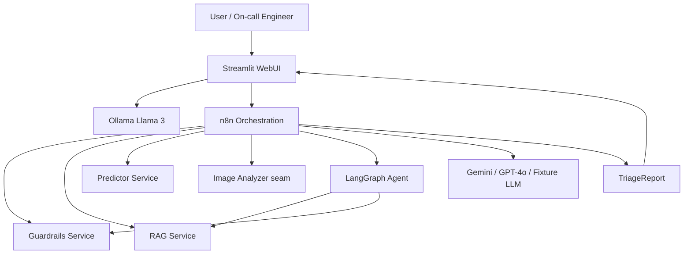

# Demo Guide — PETER PAN

5–8 minute live demonstration. Full script: [`docs/presentation/DEMO-SCRIPT.md`](presentation/DEMO-SCRIPT.md)

## Architecture (submission diagram)

## Pre-demo checklist

- [ ] `docker compose --profile bootstrap --profile ui up -d` — all healthy
- [ ] `scripts/test_layer3_health.py --include-support` — all green
- [ ] n8n workflow active (bootstrap completed)
- [ ] Ollama running with `llama3` or `llama3.1:8b` (Assistant tab)
- [ ] Browser tab at http://localhost:8501

## Demo scenario (7 minutes)

### 1. Context (30s)

"PETER PAN triages production incidents — same pipeline as the course property-triage project, domain-swapped to SRE."

### 2. Assistant tab (1 min)

Ask: *"What should I check first for a 5xx spike on orders-api?"*

Shows grounded SRE chat via Ollama or fixture LLM.

### 3. Incident submission (3 min)

Submit golden signal **orders-api error spike**:

- **Description:** Orders API 5xx rate elevated above SLO for 10 minutes
- **Service:** orders-api
- **Severity:** high

Watch sidebar health → submit → review queue shows TriageReport with:

- Category: application
- P-level
- Citations from RAG (INC-xxx)
- Predictor classification
- Owner team routing

### 4. Guardrail rejection (1 min)

Submit off-topic text (pasta recipe) → rejected at input guardrail.

### 5. Architecture callout (1 min)

Point to n8n flow, four EC2 services, deterministic floors (regex guardrails, EWMA predictor).

### 6. Evidence (30s)

Show `evaluation/results/` or Playwright screenshots in `docs/presentation/evidence/`.

## Failure modes to mention

- Fixture-first: demo works without live Gemini/GPT-4o
- GGUF generation optional behind `GGUF_MODEL_PATH`
- Flagged outputs route to human review queue, not auto-returned

## EC2 demo variant

Replace localhost with `http://<EC2_IP>:PORT`. Security group restricted to your `/32`.

## Rubric mapping

[`docs/presentation/RUBRIC-MAP.md`](presentation/RUBRIC-MAP.md)
