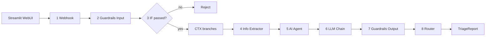

# n8n Workflow — PETER PAN

Export: [`n8n/peter-flow.json`](../n8n/peter-flow.json)  
Diagram: [`docs/peter-pan-n8n-flow.mmd`](peter-pan-n8n-flow.mmd)

## Flow name

**PETER PAN — Observability Triage**

## 8-node spine (course §3.1 crosswalk)



| Node | Course (real estate) | PETER PAN (incident ops) |
|------|---------------------|--------------------------|
| 1 | Property form POST | Signal POST `/webhook/peter-signal` |
| 2 | Validate listing | `/check/input` — ops alert, block injection |
| 3 | pass/fail | Same |
| 4 | Extract property fields | Extract service, env, severity signals (Gemini/fixture) |
| 5 | RAG + Image + LangGraph | RAG + **Predictor** + LangGraph |
| 6 | Listing brief | TriageReport (frozen JSON schema) |
| 7 | No false legal claims | No invented owners / destructive commands |
| 8 | residential vs commercial | infra / database / application routing |

## Environment variables (n8n container)

Set in `docker-compose.yml`:

- `PETER_GUARDRAILS_URL`
- `PETER_PREDICTOR_URL`
- `PETER_RAG_URL`
- `PETER_LANGGRAPH_URL`
- `PETER_TOOLS_URL`
- `PETER_*_TEAM_WEBHOOK`
- `PETER_FIXTURE_LLM_URL` (Stage A LLM seam)

## Bootstrap

```powershell
docker compose --profile bootstrap up n8n-bootstrap
```

Script: `scripts/bootstrap_n8n_local.py` — imports workflow, binds credentials, publishes webhook.

**Safety:** `test_workflow` on an *active* webhook-triggered flow can deregister the webhook. Prefer `execute_workflow`, or unpublish → test → republish.

## Stage A vs Stage C

| Stage | LLM nodes |
|-------|-----------|
| A (demo) | Fixture LLM (`fixture-llm:8010`) — deterministic, zero external API |
| C (optional) | Gemini extractor + GPT-4o agent via env credentials |

## Validation

```powershell
.\.venv\Scripts\python.exe -m pytest n8n/tests -q
.\.venv\Scripts\python.exe evaluation\run_e2e.py --entrypoint n8n --base-url http://localhost --token $env:PETER_SERVICES_TOKEN
```

Full Layer 2 evidence (EC2 + decisions): [`docs/archive/LAYER-2-VALIDATION.md`](archive/LAYER-2-VALIDATION.md).

## Re-export rule

On every n8n flow change, re-export to `n8n/peter-flow.json` and commit.
